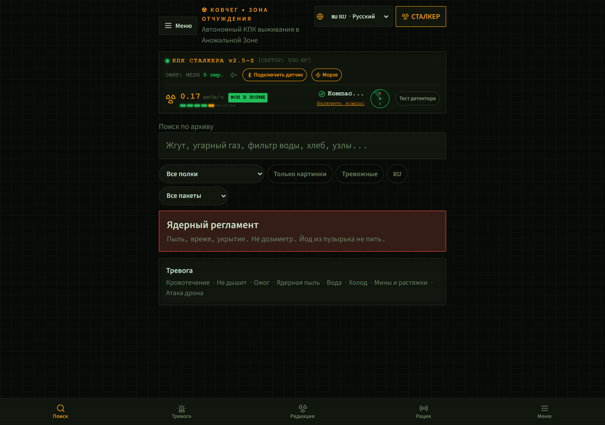
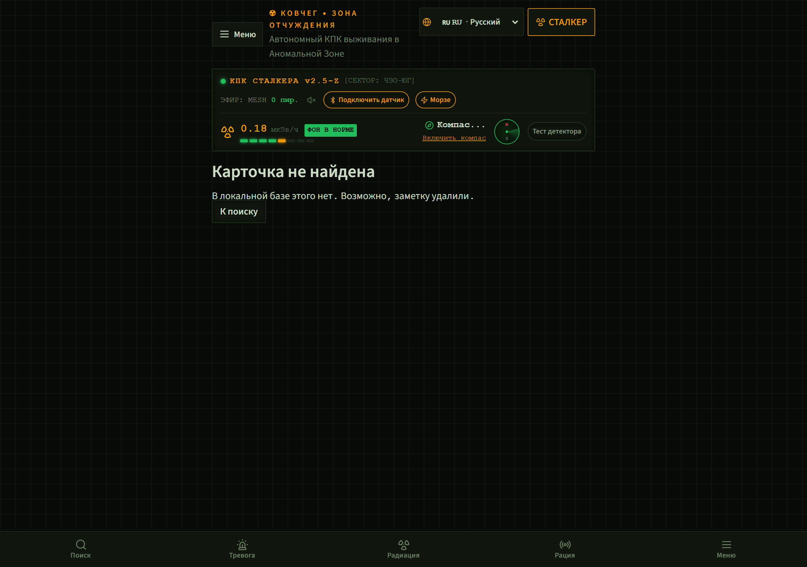
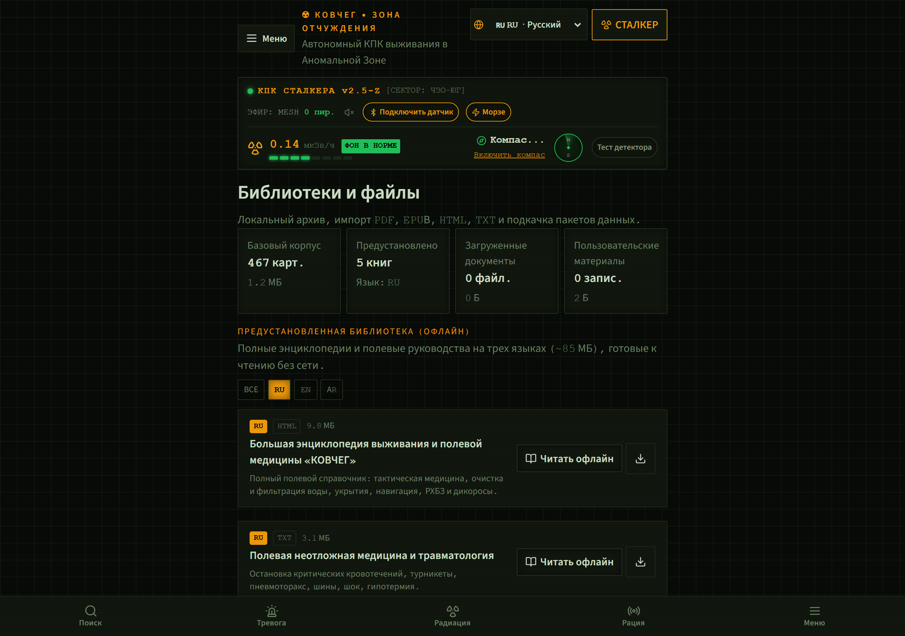
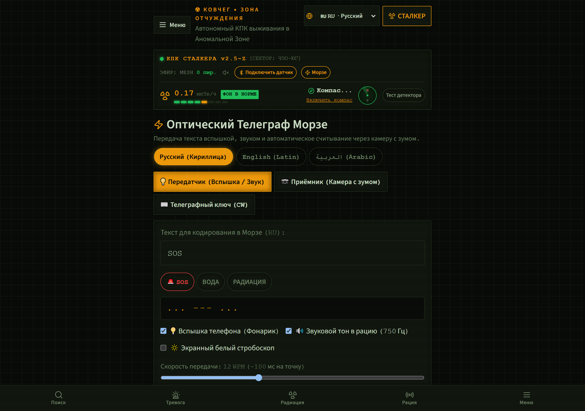
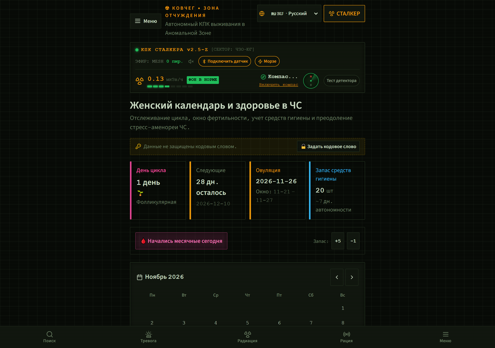
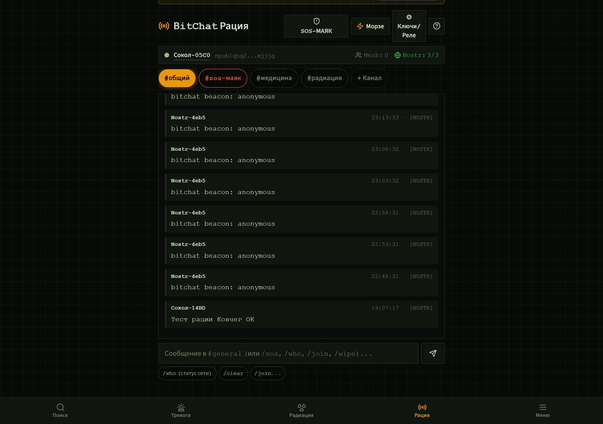
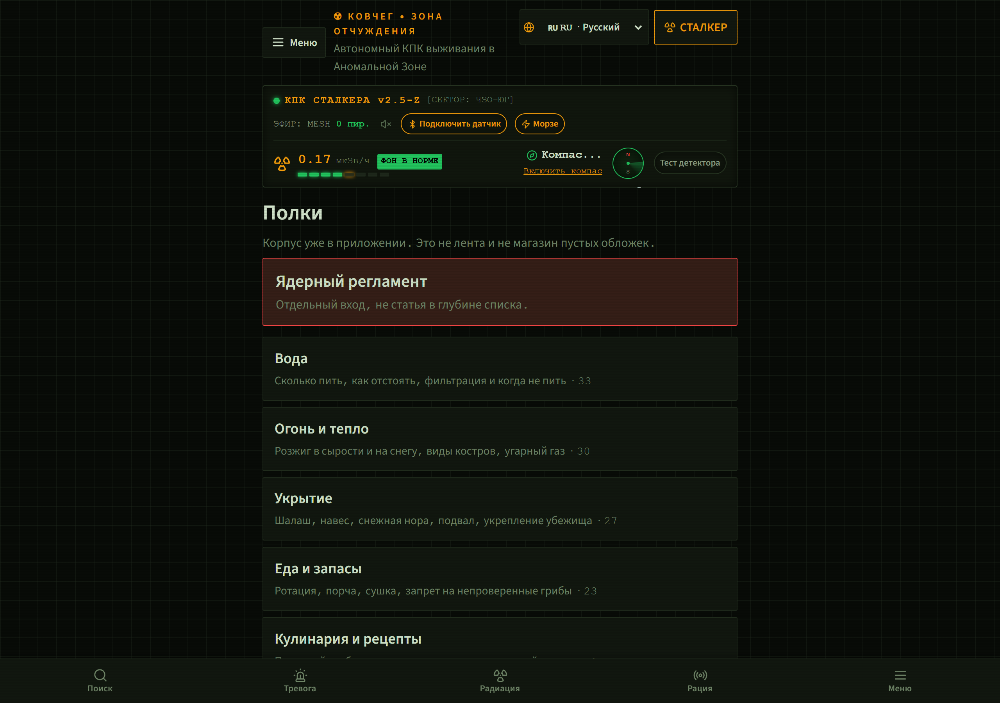
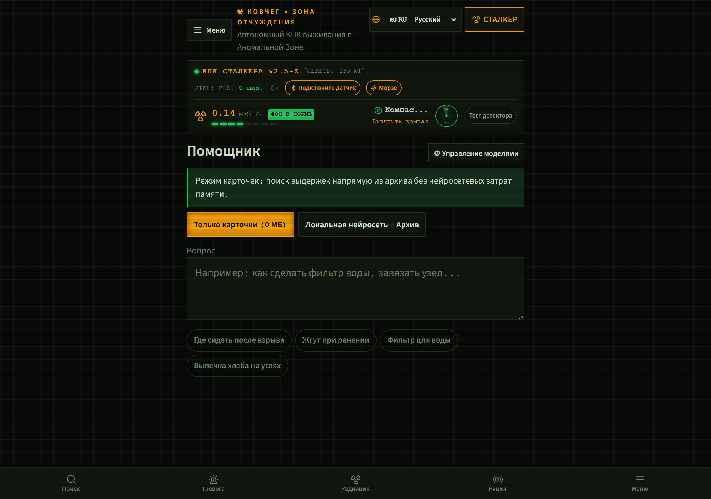
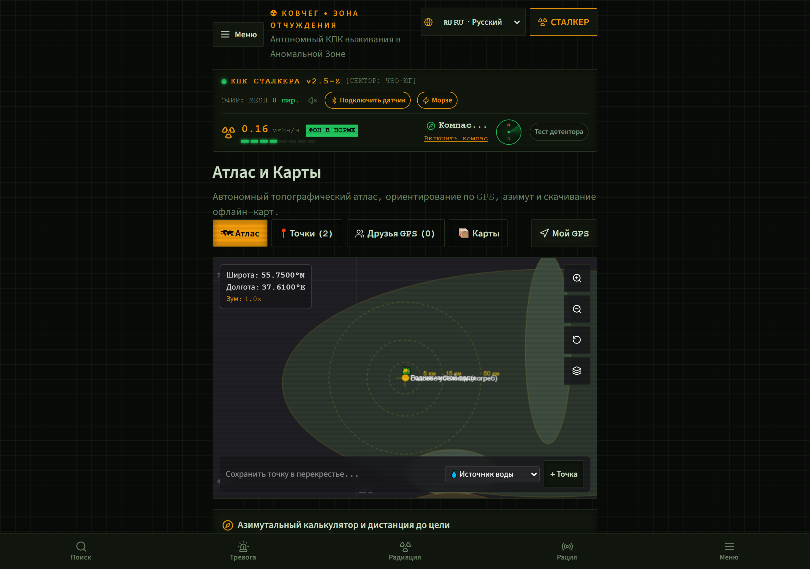

<div align="center">

# ☢️ KOVCHEG (КОВЧЕГ) / ARK
### Autonomous Offline Survival Operating System & Tactical Emergency Compendium

[-22c55e.svg?logo=android&logoColor=white)](https://github.com/G0403H/ark/releases/latest)
[](LICENSE.md)
[](#zero-cloud-architecture)
[](#multi-language-support)
[](package.json)
[](package.json)
[-336791.svg)](https://pglite.dev/)
[](#testing--verification)

<p align="center">
  <b>A complete, self-contained digital survival handbook and tactical field companion.</b><br/>
  Runs entirely inside your browser on Android, iOS, Windows, macOS, and Linux.<br/>
  <b>Zero cloud dependencies. Zero external CDNs. Zero telecommunications required.</b>
</p>

[⚡ Download APK](https://github.com/G0403H/ark/releases/latest) • [About Project](ABOUT.md) • [Key Features](#key-features) • [Showcase Gallery](#showcase-gallery) • [Interactive Tools](#interactive-field-tools) • [Hardware Links](#hardware-integrations) • [Quick Start](#quick-start) • [Documentation](docs/) • [License](#license)

</div>

---

## 🧭 Overview & Mission

**KOVCHEG (ARK)** is designed for worst-case scenarios: electromagnetic pulses (EMP), total power grid failure, telecommunications blackout, wartime conflicts, natural disasters, and deep wilderness isolation.

Unlike standard websites that break when offline, **KOVCHEG bundles 100% of its resources locally** — typography, icons, search indexes, multi-language field guides, and 11 complete survival compendiums (~88 MB of offline data) ready on day one.

### Core Tenets
1. **100% Offline-First**: No remote APIs, external CDNs, Google Fonts, or telemetry beacons.
2. **Sub-Millisecond Search**: Full-text inverted index searches 445+ survival protocol cards instantly on low-powered mobile devices.
3. **Rigorous Field Medicine**: Strict alignment with **TCCC MARCH** (Tactical Combat Casualty Care), **WHO** rehydration protocols, and international civil defense CBRN standards.
4. **Tactical Operational Security**: Master application locks, SHA-256 hashed passcodes, emergency 3x Power button SOS broadcast, and duress codes with silent panic wipe.

---

## 📸 Showcase Gallery

<div align="center">

### 1. Stalker PDA HUD & Dosimeter Gauge
*Real-time radiation monitor, Web Bluetooth BLE Geiger link, digital compass, and instant search.*


---

### 2. Wartime Defense & Anti-UAV Countermeasures
*Modern drone protection (FPV evasion, thermal infrared camouflage, trench netting) & IMAS booby trap rules.*


---

### 3. Pre-Bundled Offline Library (~88 MB) & Document Reader
*11 complete encyclopedias across 3 languages (RU, EN, AR) with custom EPUB, PDF, HTML, and TXT importers.*


---

### 4. Morse Code Transceiver & Auto-Telegraph Key
*Automated error-free Morse transmission, emergency presets, acoustic synthesizer, screen strobe, and optical pulse decoder.*


---

### 5. Women's Health & Menstrual Cycle Tracker
*Ovulation and fertility phase estimation, menstrual hygiene supply planning, and passcode lock protection.*


---

### 6. BitChat Decentralized Proximity Mesh Radio
*P2P communications without internet, radio audio cable modem schematics, and decentralized Nostr integration.*


---

### 7. Interactive Field Medical Tools
*Ischemic tourniquet countdown timer, field obstetrics contraction tracker, and WHO ORS rehydration calculator.*


---

### 8. Offline Knowledge Assistant & Local AI
*Grounded RAG retrieval on archive cards, local WebLLM weights, and deterministic fallback safety guardrails.*


---

### 9. Tactical Offline Maps & GPS Locator
*Autonomous topographical atlas, coordinate bearings, distance calculations, and friend search.*


</div>

---

## ⚡ Key Features

### 🪖 1. Military Defense & Counter-UAV Guide
- **Anti-FPV & Drop Tactics**: Acoustic detection ranges, thermal infrared signature suppression (Mylar, space blankets, multi-layer foil ponchos), and directional trench netting.
- **Zero Touch Booby-Trap Rules (IMAS)**: Comprehensive protocols on dangerous items never to pick up (toys, flashlights, power banks, abandoned radios, fishing line tripwires, submunitions).
- **Bombardment Cover**: Structural survivability formulas for basements, trenches, and concrete revetments against artillery, Grad rockets, and glide bombs.

### ☢️ 2. Stalker PDA & CBRN Radiation Monitor
- **Web Bluetooth BLE Support**: Connects directly to external physical dosimeters (RadiaCode, AtomFast, or open-source ESP32/SBM-20 Geiger counters).
- **Acoustic Geiger Audio**: Simulates realistic Geiger-Müller clicks proportional to ionizing radiation levels using Web Audio oscillators.
- **Fallout Radiation Physics**: The 7/10 rule calculation for decay over time ($R_t = R_1 \cdot t^{-1.2}$) and halving layer thicknesses for soil, concrete, steel, and lead.

### 📻 3. Morse Code Transceiver & Telegraph Key
- **Automated Text Transmission**: Type arbitrary text or click quick emergency presets (`SOS`, `HELP`, `WATER`, `MINES`, `DRONE`, `RADIATION`) for automated, 100% error-free transmission.
- **Dual Mode**: Switch seamlessly between **Auto-Transmission** and **Manual Telegraph Key** for practicing tapping rhythm.
- **Optical & Acoustic Output**: Synchronized 750 Hz audio tone, full-screen optical strobe flasher, and camera LED torch toggling.
- **Optical Pulse Decoder**: Real-time camera or screen tap decoder translating light pulses back into text.

### 🌸 4. Women's Health & Field Obstetrics
- **Cycle & Ovulation Calculator**: Tracks follicular, ovulation, and luteal phases without any network telemetry.
- **Hygiene & Medical Rations**: Calculates required pads, tampons, antiseptic wash, and analgesics based on displacement duration and family count.
- **Contraction & Labor Tracker**: Measures contraction frequency and duration, automatically signaling active labor stages with field delivery checklists.
- **Privacy Lock**: Personal cycle logs can be locked behind a master passcode or concealed during device checks.

### 🩺 5. Interactive Emergency Calculators
- **Tourniquet Timer**: Tracks exact application time with auditory and visual warnings for 1.5-hour and 2-hour ischemic limb thresholds.
- **WHO Oral Rehydration Salts (ORS)**: Exact measurements for clean water (1L), salt (1/2 tsp / 2.5g), and sugar (6 level tsp / 30g) for treating cholera, dysentery, and heat stroke.
- **Parkland Burn Formula**: Calculates Ringer's Lactate / fluid resuscitation volumes based on Total Body Surface Area (TBSA) and the "Rule of Nines".
- **Water Boiling at Altitude**: Dynamic boiling point adjustments for elevation (100°C down to 85°C) with compensatory boiling times and chlorine tablet dosing.

### 💬 6. BitChat Offline Mesh Radio
- **P2P Local Chat**: Communicates across local device networks, peer WebRTC channels, and decentralized Nostr relays.
- **Radio Cable Modem**: Complete pinouts for connecting a smartphone's 3.5mm TRRS audio jack to handheld VHF/UHF transceivers (Baofeng UV-5R, Quansheng) to transmit digital text packets at 1200 baud AFSK.

---

## 🛠️ Tech Stack & Architecture

| Layer | Technologies |
|---|---|
| **Framework** | [TanStack Start](https://tanstack.com/start), [React 19](https://react.dev/), [TanStack Router](https://tanstack.com/router) |
| **Styling** | [Tailwind CSS v4](https://tailwindcss.com/) with custom Shelter, Paper, and Stalker themes |
| **Offline Database** | [PGLite](https://pglite.dev/) (WASM-embedded PostgreSQL running inside browser IndexedDB) |
| **Search Engine** | Custom In-Memory Inverted Index with BM25 TF-IDF token scoring |
| **Audio & Comms** | Web Audio API (750 Hz synthesizer, AFSK modem), Web Bluetooth API (GATT BLE) |
| **Sensors** | Geolocation API, DeviceOrientation API (Magnetometer / Compass) |
| **Bundler** | [Vite 8](https://vitejs.dev/) with full static asset pre-bundling (Zero CDN dependencies) |

---

## 🔐 Tactical Security & Privacy

KOVCHEG operates under a strict **Zero-Trust Local Device** model:

- **Master App Lock**: Full-screen gate requiring a PIN or passphrase to access any part of the application.
- **Tactical Passcode**: SHA-256 hashed access gate protecting military defense sections and private notes.
- **Duress Code (Panic Wipe)**: If forced to unlock the device under duress, entering the secondary decoy code unlocks benign survival articles while silently wiping private notes, cycle logs, and GPS caches.
- **3x Power Button SOS Beacon**: Pressing the physical Power button 3 times within 2.5 seconds immediately logs GPS coordinates and broadcasts a high-priority distress beacon.

Read the complete [Tactical Security Guide](docs/TACTICAL_SECURITY.md).

---

## 🌐 Multi-Language Support

KOVCHEG supports full run-time switching across 3 languages with complete Right-to-Left (RTL) support:

- 🇷🇺 **Russian (Русский)** — Primary comprehensive edition with 445+ core protocol cards.
- 🇬🇧 **English (English)** — Complete international edition with all medical, military, and bushcraft compendiums.
- 🇸🇦 **Arabic (العربية)** — Complete Middle Eastern & North African edition with specialized desert survival protocols and RTL layout.

---

## 🚀 Quick Start

### Prerequisites
- [Node.js](https://nodejs.org/) v20+ or v24+
- Modern Web Browser (Chrome, Edge, Firefox, Safari)

### Installation
```bash
# Clone repository
git clone https://github.com/G0403H/ark.git
cd ark

# Install dependencies
npm install

# Run local development server
npm run dev
```

Visit `http://localhost:8080` in your browser.

### Production Build & Preview
```bash
# Run typecheck
npm run typecheck

# Run automated tests (88 test cases)
npm test

# Build production bundle
npm run build

# Preview production build locally
npm run preview
```

---

## 📚 Documentation Index

- [About & Humanitarian Mission](ABOUT.md) — Project origin, resilience philosophy, and offline distribution.
- [System Architecture](docs/ARCHITECTURE.md) — Technical internals, memory footprints, and DSP pipelines.
- [Tactical Security & Duress Codes](docs/TACTICAL_SECURITY.md) — App lock, SHA-256 hashing, and emergency panic wipes.
- [Offline Data Packs](docs/DATA_PACKS.md) — Pre-bundled encyclopedias and instructions for importing ZIM / PDF / EPUB files.
- [Hardware Integrations & DIY Guides](docs/HARDWARE_INTEGRATIONS.md) — Schematics for SBM-20 dosimeters, radio modems, and Yagi antennas.

---

## 📄 License

This project is licensed under the **PolyForm Noncommercial License 1.0.0**.

See the full [LICENSE.md](LICENSE.md) file for legal details.

### Humanitarian & Civilian Survival Notice
KOVCHEG is developed as a free civilian survival, disaster preparedness, and humanitarian resilience initiative. Personal use, emergency preparedness, disaster relief operations, community civilian defense, educational use, and non-profit deployments are 100% permitted without restriction.

---

<div align="center">
  <b>Built for resilience. When the grid fails, KOVCHEG remains.</b>
</div>
