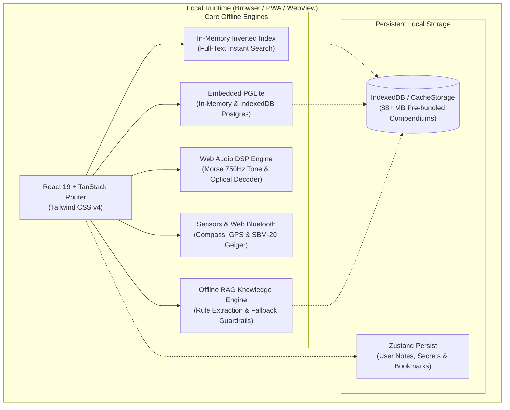

# System Architecture & Technical Design

**KOVCHEG (ARK)** is an autonomous, offline-first tactical survival operating system designed to run on any smartphone, tablet, or laptop during total telecommunications and power infrastructure blackout.

---

## 1. Zero-Cloud / Zero-CDN Philosophy

Most modern web applications rely on remote CDN assets (Google Fonts, unpkg, Cloudflare, font awesome, external analytics). In an actual emergency (grid collapse, cyberwarfare, natural disaster, isolated wilderness):
- **All external network calls fail or block page rendering.**
- **KOVCHEG bundles 100% of its runtime assets locally**:
  - Fonts: Source Sans 3 and Literata self-hosted as WOFF2 in `public/assets/`.
  - Icons: Lucide React bundled directly into the JavaScript client bundle.
  - Offline Books: 11 full compendiums pre-bundled in `public/library/` in HTML and TXT formats (~88 MB).
  - Search Index: Pre-computed token dictionary with client-side BM25-like TF-IDF scoring in memory.

---

## 2. In-Memory Search Engine

The core archive search runs without external backend services:
- **Corpus**: 445+ survival protocol cards spanning 10 core disciplines (Nuclear/CBRN, Trauma Aid, Water Purification, Fire & Heat, Wilderness Bushcraft, Field Obstetrics, Wartime Anti-UAV Defense, Foraging, Radio & Comms, and Knot Craft).
- **Indexing**: Cards are tokenized, normalized, and indexed by shelf, keywords, and trigrams.
- **Search Latency**: Less than 1 millisecond on low-end Android smartphones.

---

## 3. Acoustic & Optical Morse DSP

The Morse Transceiver module (`src/lib/kovcheg/morse/` and `src/components/kovcheg/morse-transceiver.tsx`) implements standard international Morse telegraphy:
- **Audio Synthesis**: Uses standard Web Audio API `OscillatorNode` with 750 Hz sinusoidal waves and exponential ramping to eliminate speaker clicks.
- **Timing Accuracy**: Conforms to standard Morse timing (1 unit = dot, 3 units = dash, 1 unit = intra-symbol space, 3 units = inter-letter space, 7 units = word space).
- **Automated Text Transmission**: Translates user-entered text (or emergency presets like `SOS`, `HELP`, `WATER`, `RADIATION`, `DRONE`) into precise timing chains.
- **Optical Decoding**: High-contrast full-screen strobe flasher and camera torch toggle for visual signaling over long distances.

---

## 4. Web Bluetooth & Hardware Sensor Link

Smartphones lack physical Geiger-Müller tubes. KOVCHEG interfaces with real external radiation hardware:
- **Web Bluetooth API**: Pairs with standard BLE dosimeters (RadiaCode, AtomFast, and open-source DIY ESP32/SBM-20 counters).
- **GATT Environmental Sensing**: Reads micro-Sieverts per hour (`µSv/h`) in real-time.
- **Acoustic Geiger Clicks**: Simulates or emits proportional audio clicks using Web Audio sound synthesis.
- **Device Orientation API**: Direct access to magnetometer and accelerometer for magnetic azimuth and cardinal direction compass.

---

## 5. Security Architecture

All user data (personal medical logs, menstrual cycle dates, radio logs, and survival notes) is protected locally:
- **Master Entry Lock**: Pin or password protection screen preventing unauthorized physical access to the device.
- **Tactical Security Gate**: SHA-256 hashed access codes for military and counter-drone defense sections.
- **Duress Panic Wipe**: Entering a predetermined decoy code instantly purges all sensitive notes, cycle logs, and GPS caches, leaving only benign survival articles.
